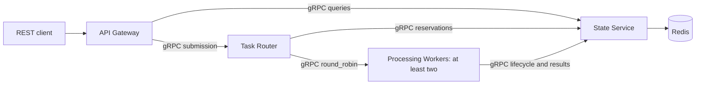

# TaskRelay

A C++20 distributed task-processing laboratory with gRPC microservices, Redis coordination, and planned Docker and Kubernetes deployments.

**Status: phase 1 — C++/gRPC foundation verified locally on Ubuntu 24.04.** Versioned contracts, a foundation worker, a one-shot router health probe, and nine passing tests are present. Task execution, REST, Redis, deployments, and telemetry remain planned. No successful GitHub Actions run or performance result is claimed.

TaskRelay is an independent project for exploring concurrency, distributed state, failure recovery, and observability. It processes bounded numeric workloads, data transformations, and entirely local synthetic network simulations.

## Design



The State Service owns all Redis access. The router reserves queued work and distributes execution RPCs across workers. Expiring leases and fencing tokens protect accepted state updates; processing has at-least-once semantics, with possible repeated computation.

## Documentation

- [Requirements and acceptance criteria](docs/requirements.md)
- [Architecture, dependencies, and target repository structure](docs/architecture.md)
- [REST and gRPC contract design](docs/grpc-contracts.md)
- [State machine and failure model](docs/resilience.md)
- [Development phases, validation, and GitHub workflow](docs/development-plan.md)

## Development status

Phase 0 defines the design. Phase 1 adds CMake, locked Ubuntu dependencies, an optional pinned vcpkg profile, build-time Protobuf generation, a real gRPC health exchange, and initial formatting/static-analysis/build/test CI. `ExecuteTask` deliberately returns UNIMPLEMENTED; the worker advertises foundation health rather than processor readiness.

## Build on Linux or Ubuntu WSL

The default target is Ubuntu 24.04 x86-64 with GCC 13, CMake 3.28 or newer, Ninja, and Clang tooling 18. Docker is not required for phase 1. The default profile uses Ubuntu packages for gRPC 1.51.1, Protobuf 3.21.12, and GoogleTest/GoogleMock 1.14.0. Exact Debian package revisions and their related libraries are recorded in [the dependency lock](scripts/dependencies-ubuntu2404.lock). Bootstrap verifies installed revisions and installs them only when `--install-tools` is supplied.

```sh
bash scripts/bootstrap-ubuntu.sh --install-tools
cmake --preset linux-debug
cmake --build --preset linux-debug
ctest --preset linux-debug
```

Run these commands inside the repository using a Linux/WSL shell. The bootstrap rejects unsupported distributions or architectures and verifies exact library package revisions. If a locked package is no longer available from configured Ubuntu mirrors, fail rather than silently upgrade; update the lock through review or restore a suitable Ubuntu package snapshot. Base OS security updates are not frozen by this library lock, so this is not a claim of bit-identical binaries.

For a repository stored on a Windows/OneDrive mount, keep build outputs in the Linux filesystem:

```sh
cmake --preset linux-analysis -B "$HOME/.cache/taskrelay/build/foundation"
cmake --build "$HOME/.cache/taskrelay/build/foundation" --parallel 2
ctest --test-dir "$HOME/.cache/taskrelay/build/foundation" --output-on-failure
```

`linux-analysis` enables clang-tidy 18 on project sources. Generated sources are excluded. Run `python3 scripts/check-format.py` to check formatting, or add `--fix` to apply it. The `linux-release` preset builds optimized project code.

## Optional source dependency profile

The vcpkg manifest and tool checkout are pinned to `67972e92edd181d433927b42d8ab4bfa52ac164a`, selecting gRPC 1.81.1, Protobuf 7.36.2, and GoogleTest 1.18.0. The initial complete source build was too expensive for the routine foundation workflow and was stopped during gRPC compilation. Its full build and runtime tests are **not verified**. The default Ubuntu profile is the supported phase 1 validation target and the CI target.

```sh
bash scripts/bootstrap-wsl.sh --install-tools
export VCPKG_ROOT="$HOME/.cache/taskrelay/vcpkg/$(python3 -c 'import json; print(json.load(open("vcpkg.json"))["builtin-baseline"])')"
export VCPKG_MAX_CONCURRENCY=2
cmake --preset linux-vcpkg-debug
cmake --build --preset linux-vcpkg-debug
ctest --preset linux-vcpkg-debug
```

This optional path downloads and compiles dependencies into caches and can take substantially longer. The release-only triplet avoids compiling each dependency twice. Project code still follows its Debug preset. Bootstrap refuses to modify an existing vcpkg checkout at a different revision. Do not combine generated files or library paths from the two profiles.

## Try the foundation exchange

After building with the default `linux-debug` preset, start the worker in one terminal:

```sh
./build/debug/services/processing-worker/taskrelay-worker 127.0.0.1:50051
```

In another terminal, run the one-shot router probe:

```sh
./build/debug/services/task-router/taskrelay-router dns:///localhost:50051
```

It prints `Worker foundation health: SERVING` and exits successfully when the foundation health service responds within 500 ms. A stopped or unavailable worker produces a nonzero exit within the deadline. Use Ctrl+C to stop the worker. These processes use insecure loopback transport for local development; they are not a deployment or the complete task-routing implementation.

For an external build directory, replace `./build/debug` with that directory. The automated process smoke test starts the actual worker and router binaries, checks success, stops the worker, and confirms an unavailable-worker failure.

## Contribution workflow

Use English for documentation, code, comments, user-facing messages, commits, and pull requests. Use a focused branch and pull request for each approved phase, with small conventional commits and recorded validation. The `main` branch contains reviewed phases; phase 0 was merged through PR #1 in the public [TaskRelay repository](https://github.com/ABDOUUisHERE/taskrelay). Phase 1 is developed on `build/cpp-grpc-foundation` before publication and review.

Before each implementation phase, present the file list and obtain approval. Publishing commits to GitHub requires explicit authorization. See the [development plan](docs/development-plan.md) for the complete workflow.
