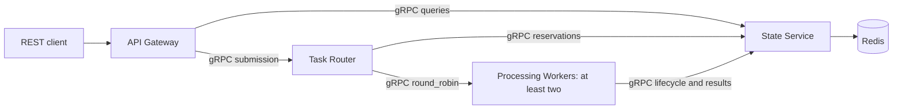

# TaskRelay

A C++20 distributed task-processing laboratory with gRPC microservices, Redis coordination, and planned Docker and Kubernetes deployments.

**Status: phase 0 — architecture documented; implementation has not started.** This repository contains design documents only. No service, deployment, CI run, or performance result is claimed to work yet.

TaskRelay is an independent project for exploring concurrency, distributed state, failure recovery, and observability. It processes bounded numeric workloads, data transformations, and entirely local synthetic network simulations.

## Design

The State Service owns all Redis access. The router reserves queued work and distributes execution RPCs across workers. Expiring leases and fencing tokens protect accepted state updates; processing has at-least-once semantics, with possible repeated computation.

## Documentation

- [Requirements and acceptance criteria](docs/requirements.md)
- [Architecture, dependencies, and target repository structure](docs/architecture.md)
- [REST and gRPC contract design](docs/grpc-contracts.md)
- [State machine and failure model](docs/resilience.md)
- [Development phases, validation, and GitHub workflow](docs/development-plan.md)

## Development status

Phase 0 defines the design. Phase 1 will introduce CMake, dependency pinning, Protobuf code generation, an initial gRPC exchange, and build checks. Build and startup commands will be documented once they are executable and verified.

The inspected environment has GCC 13.3.0 in Ubuntu WSL, Git 2.44.0, Python 3.14.2, Docker CLI 29.1.2, Compose 2.40.3, and kubectl 1.34.1. CMake, Ninja, protoc, Clang tooling, and Kind were unavailable in the checked environments. Docker engine availability remains unverified after an unresponsive query.

## Contribution workflow

Use English for documentation, code, comments, user-facing messages, commits, and pull requests. Use a focused branch and pull request for each approved phase, with small conventional commits and recorded validation. The `main` branch contains only the repository bootstrap; `docs/architecture` contains phase 0 for pull-request review in the public [TaskRelay repository](https://github.com/ABDOUUisHERE/taskrelay).

Before each implementation phase, present the file list and obtain approval. Publishing commits to GitHub requires explicit authorization. See the [development plan](docs/development-plan.md) for the complete workflow.
