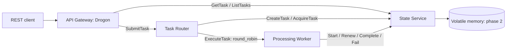

# Cloud-Native Distributed Microservices Platform

A C++20 distributed task-processing laboratory. The internal package and executable prefix is `taskrelay`.

**Status: phase 2 implemented and verified locally on the locked Ubuntu profile.** Four services implement REST submission, gRPC dispatch, three bounded workloads, and volatile in-memory task state. Redis coordination, recovery/retries, containers, Kubernetes, telemetry, and benchmarks remain later phases.

## Service flow



The router stores a task before returning HTTP 202 and dispatches one task at a time through its shared round-robin worker channel. The worker has two processing threads and a queue of eight. Submission keys replay the retained task for the same typed input and return a conflict for a different input. State transitions check attempt tokens and worker ownership. These are local laboratory guarantees: restarting the State Service loses every task and idempotency key. Redis durability and restart recovery are not implemented yet.

## Build on Ubuntu 24.04 or WSL

Use Ubuntu 24.04 amd64, GCC 13, CMake 3.28+, Ninja, and Clang tooling 18. The default profile locks gRPC 1.51.1, Protobuf 3.21.12, GoogleTest 1.14.0, and Drogon 1.8.7, including development dependencies needed by Ubuntu's Drogon CMake export.

```sh
bash scripts/bootstrap-ubuntu.sh --install-tools
cmake --preset linux-analysis
cmake --build --preset linux-analysis
ctest --preset linux-analysis
python3 scripts/check-format.py
```

The bootstrap installs packages only with `--install-tools`, verifies exact revisions in [the package lock](scripts/dependencies-ubuntu2404.lock), and rejects other distributions/architectures. A missing revision is an error; review the lock or restore a suitable package snapshot rather than silently upgrading. The complete base OS and security updates are not frozen; bit-identical binaries are not promised.

On WSL with source on Windows/OneDrive, keep outputs in the Linux filesystem. Restricting PATH avoids slow CMake searches through Windows software directories:

```sh
export PATH=/usr/local/sbin:/usr/local/bin:/usr/sbin:/usr/bin:/sbin:/bin
cmake --preset linux-analysis -B "$HOME/.cache/taskrelay/build/analysis"
cmake --build "$HOME/.cache/taskrelay/build/analysis" --parallel 2
ctest --test-dir "$HOME/.cache/taskrelay/build/analysis" --output-on-failure
```

`linux-analysis` runs clang-tidy on project sources, with compiler/lint warnings treated as errors. Generated code is excluded. `linux-debug` omits static analysis, and `linux-release` enables optimized compilation. Add `--fix` to the format script to apply formatting.

## Run the four services

After a default build, run one command in each of four terminals, in this order:

```sh
./build/analysis/services/state-service/taskrelay-state 127.0.0.1:50052
./build/analysis/services/processing-worker/taskrelay-worker 127.0.0.1:50051 127.0.0.1:50052
./build/analysis/services/task-router/taskrelay-router 127.0.0.1:50053 127.0.0.1:50052 127.0.0.1:50051
./build/analysis/services/api-gateway/taskrelay-gateway 8080 127.0.0.1:50053 127.0.0.1:50052
```

Replace `./build/analysis` with your external build directory when applicable. The gateway binds loopback only; gRPC uses insecure transport and defaults to loopback. This is a trusted local demonstration, without authentication or TLS. Stop processes with Ctrl+C, preferably gateway, router, worker, then state.

Submit a transformation:

```sh
curl -i http://127.0.0.1:8080/api/v1/tasks \
  -H 'Content-Type: application/json' \
  -H 'Idempotency-Key: example-transform' \
  -H 'X-Correlation-Id: example-request' \
  -d '{"type":"TASK_TYPE_TRANSFORM","executionTimeout":"2s","transform":{"operation":"OPERATION_ASCII_UPPERCASE","data":"hello"}}'
```

HTTP 202 includes the public task representation, `Location`, and `X-Idempotency-Replayed`. Query the returned location until the state is COMPLETED or FAILED:

```sh
curl http://127.0.0.1:8080/api/v1/tasks/REPLACE_WITH_TASK_ID
curl 'http://127.0.0.1:8080/api/v1/tasks?page_size=20&state=TASK_STATE_COMPLETED'
curl http://127.0.0.1:8080/health/live
curl http://127.0.0.1:8080/health/ready
```

REST uses Protobuf JSON: enum names are explicit, 64-bit integers serialize as decimal strings, durations use seconds such as `"2s"`, and absent default scalar fields mean their Protobuf defaults. Unknown fields, unsupported operations, invalid UTF-8, and oversized inputs are rejected. See [the contracts](docs/grpc-contracts.md) for numeric and network input shapes and error mapping.

The gateway has four RPC transport threads and 32 queued requests. Its live route runs directly on the HTTP event loop. Ready checks the State Service and router; it returns 503 when either is unavailable. gRPC health reports local service registration; dependency-aware internal readiness remains phase 4 work. `/metrics` and HTTP administration listeners for internal services remain phase 7 work.

The memory store retains at most 1024 tasks, with a 60-second global task lifetime and ten-minute terminal retention. Lease expiry or dispatch failure finalizes FAILED in this phase; automatic retries and recovery are deferred. The synthetic network workload never contacts a remote host: packet delay is simulated model time, not wall-clock sleeping.

A one-shot worker health probe remains available:

```sh
./build/analysis/services/task-router/taskrelay-router --probe 127.0.0.1:50051
```

## Optional source dependency profile

The vcpkg manifest/tool checkout use baseline `67972e92edd181d433927b42d8ab4bfa52ac164a`. It selects newer gRPC/Protobuf/GoogleTest plus Drogon and OpenSSL. The full source profile remains **unverified**: the original build was stopped during gRPC compilation, and the added HTTP dependency has not been source-built. The locked Ubuntu profile is the validation and CI target.

```sh
bash scripts/bootstrap-wsl.sh --install-tools
export VCPKG_ROOT="$HOME/.cache/taskrelay/vcpkg/$(python3 -c 'import json; print(json.load(open("vcpkg.json"))["builtin-baseline"])')"
export VCPKG_MAX_CONCURRENCY=2
cmake --preset linux-vcpkg-debug
cmake --build --preset linux-vcpkg-debug
ctest --preset linux-vcpkg-debug
```

Do not mix generated bindings or dependency paths between profiles.

## Documentation and contribution

- [Architecture and target topology](docs/architecture.md)
- [Requirements and acceptance criteria](docs/requirements.md)
- [REST and gRPC contracts](docs/grpc-contracts.md)
- [State machine and failure model](docs/resilience.md)
- [Testing and reproducible checks](docs/testing.md)
- [Development phases and GitHub workflow](docs/development-plan.md)

Use English throughout the project and focused conventional commits on a phase branch. Phases 0 and 1 were reviewed and merged through PRs #1 and #2 in [the public repository](https://github.com/ABDOUUisHERE/Cloud-Native-Distributed-Microservices-Platform). Phase 2 is developed on `feat/task-processing`. Each phase needs scope approval; publishing commits and merging require authorization.
