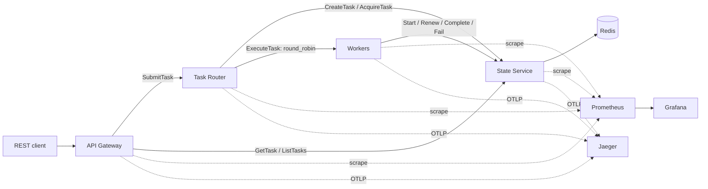

# Architecture

Status: phase 0 design. Implementations and exact dependency revisions remain to be validated in later approved phases.

## Service boundaries



| Component | Responsibilities | Initial replicas |
| --- | --- | --- |
| API Gateway | Bounded REST input validation, correlation IDs, gRPC clients, HTTP error mapping | 1 |
| Task Router | Submission, bounded dispatch loop, admission control, recovery scheduling | 1 |
| Processing Worker | Bounded executor, deterministic workloads, lease renewal, result publication | At least 2 |
| State Service | All Redis access, atomic state/index updates, lease fencing, retention | 1 |
| Redis | Temporary authoritative task state and coordination with persistent volume | 1 |

Each component has independent configuration and health endpoints. Shared code contains configuration, transport helpers, telemetry, resilience primitives, and thread-pool utilities; service-specific business rules stay with their owner.

## Submission and execution

1. The gateway validates a request and forwards the task specification and idempotency key to the router.
2. The router calls `CreateTask`. An atomic operation creates the record, idempotency mapping, creation index, and ready-queue entry. A duplicate with the same canonical input returns the existing task.
3. Only after storage succeeds does the gateway return HTTP 202, a task ID, and a Location header. A lost response is resolved by retrying with the same key.
4. A bounded router loop calls `AcquireTask`. The State Service atomically removes an eligible task from the ready queue, increments its attempt counter, issues a new fencing token, and indexes its lease expiry.
5. The router calls `ExecuteTask` through its shared gRPC worker channel. The worker admits the request only when its bounded executor has capacity.
6. The worker calls `StartTask` before computation. The State Service binds the token to the worker instance and changes the state to RUNNING. A duplicate start never launches a second local execution for that token.
7. The worker periodically renews its lease through a control path independent of saturated processing threads.
8. The worker publishes completion or failure to the State Service. Only the current, unexpired token can mutate the task. The execution RPC returns after publication, or reports uncertainty when the storage result cannot be confirmed.
9. The router consults state after an ambiguous RPC outcome. It does not blindly invalidate a live worker lease. Expired reservations are recovered atomically by the State Service.

`AcquireTask` also performs a bounded recovery sweep; the router polls it even when no new tasks exist. Retention cleanup uses a separate bounded maintenance timer in the State Service. Restart recovery is based on Redis indexes rather than process-local timers.

## Dispatch and discovery

Use one dispatch mechanism: gRPC client-side `round_robin`. Redis is a durable scheduling queue, not a competing worker consumer mechanism; Redis Streams are outside the initial design.

On Kubernetes, a headless Service supplies ready worker Pod addresses through DNS. The gRPC client must resolve the complete address list, select `round_robin`, and refresh membership as Pods change. A phase 6 test must prove that a long-lived router process discovers added and removed workers. If the selected gRPC resolver does not satisfy this requirement, adjust the resolver before claiming dynamic scaling works.

Compose will define two named worker services with resolvable endpoints; phase 5 will verify how the chosen resolver consumes that explicit endpoint list. An ordinary Kubernetes ClusterIP alone is insufficient evidence of per-RPC balancing over persistent HTTP/2 connections.

Round-robin balances RPC selections rather than CPU cost. A saturated worker returns RESOURCE_EXHAUSTED before accepting work. The router uses backpressure and bounded delayed retries. Per-worker execution counters demonstrate distribution without requiring identical counts.

Reference: [gRPC load-balancing policies](https://grpc.io/docs/guides/custom-load-balancing/).

## Redis data model

| Key | Type | Purpose |
| --- | --- | --- |
| `task:<id>` | Hash | Typed input/result encoding, state, timestamps, attempt count, token, owner, expiry, error |
| `idempotency:<key-hash>` | Hash | Task ID, canonical request fingerprint, retention metadata |
| `queue:ready` | Sorted set | Task IDs scored by earliest eligible dispatch time |
| `leases:expires` | Sorted set | Leased task IDs scored by lease expiry |
| `tasks:created` | Sorted set | Creation-time task index for bounded pagination |
| `tasks:expires` | Sorted set | Task deadline or terminal-retention cleanup schedule |

Versioned Lua scripts perform lifecycle changes and related index operations atomically. Validate all preconditions before writes: Redis script isolation does not roll back writes made before a script error. Use Redis time for lease decisions to avoid client clock disagreement. Hash the idempotency key and canonicalize typed input before fingerprinting. Reject conflicting reuse.

Active tasks have a global processing deadline; terminal records expire after a retention window. Cleanup removes all relevant index entries and idempotency metadata together. A lost cleanup process must cause delayed cleanup, not unsafe acceptance of expired tokens; each state mutation independently checks expiry. Retained dangling index entries are removed defensively on reads.

The initial design targets one Redis primary, not Redis Cluster. Cross-key scripts cannot be migrated to a sharded cluster without a key-slot and data-partitioning design. Configure AOF, a persistent volume, `noeviction`, and application admission limits. AOF with periodic fsync can lose recently acknowledged writes after a host crash; this is a laboratory durability limit, not a durable-message-broker guarantee.

## C++ dependencies

| Area | Proposed dependency | Reason |
| --- | --- | --- |
| Toolchain | C++20, CMake, Ninja | Explicit build targets and repeatable Linux builds |
| Dependency management | vcpkg manifest mode | Single recorded baseline and pinned vcpkg checkout |
| HTTP | Drogon | HTTP routing and asynchronous response handling |
| RPC | gRPC C++, Protobuf | Typed versioned interfaces and explicit deadlines |
| Redis | redis-plus-plus, hiredis | C++ Redis client with connection pooling |
| Logging | spdlog | Structured event output with controlled fields |
| Testing | GoogleTest, GoogleMock | Unit assertions and dependency substitution |
| Metrics | prometheus-cpp | Prometheus counters, gauges, and histograms |
| Tracing | OpenTelemetry C++ | W3C context propagation and OTLP export |

Do not block Drogon's HTTP event loop on synchronous RPCs. Initially use bounded transport executors for blocking RPCs and a separate worker processing pool; use `std::jthread`, RAII, cooperative cancellation, and explicit shutdown ownership. Bound thread counts and request queues. The maximum execution duration must include queueing and serialization time.

Phase 1 will record exact dependency versions, a full vcpkg baseline SHA and tool checkout revision, and a successful compatibility build. Container base images and GitHub Actions will be pinned as they are introduced. Avoid floating branches or `latest` tags in validated builds.

Primary references: [Drogon](https://github.com/drogonframework/drogon), [redis-plus-plus](https://github.com/sewenew/redis-plus-plus), [prometheus-cpp](https://github.com/jupp0r/prometheus-cpp), [OpenTelemetry C++](https://opentelemetry.io/docs/languages/cpp/), and [vcpkg versioning](https://learn.microsoft.com/en-us/vcpkg/users/versioning).

## Deployment and security

Use Linux builder containers and small runtime images with nonroot users. Apply explicit memory/CPU limits, read-only filesystems where supported, bounded request/result sizes, and private administration ports. Compose publishes the gateway and demonstration UIs only on localhost by default; Redis has no host port. Kubernetes uses internal Services, secret references, and network policies where the cluster CNI enforces them.

Secret values are injected at runtime and never checked in or included in logs. Redis authentication and dedicated ACL credentials belong in deployment configuration. The initial trusted local laboratory is not an Internet-ready or multi-tenant API. Authentication and transport encryption beyond that boundary require a separately reviewed design before external exposure.

Metrics use bounded labels such as service, operation, task type, status, and worker instance. Task IDs and correlation IDs belong in traces and logs, not metric labels. Export latency histograms for quantiles; record average latency through histogram sums/counts. Telemetry exporter failures must not block task completion.

## Target repository structure

Only phase 0 documents and repository metadata exist initially. The target below is not a list of implemented components.

```text
nexusmesh/
|-- services/
|   |-- api-gateway/
|   |-- task-router/
|   |-- processing-worker/
|   `-- state-service/
|-- common/
|   |-- config/
|   |-- grpc/
|   |-- resilience/
|   |-- telemetry/
|   `-- threading/
|-- proto/nexusmesh/v1/
|-- redis/scripts/
|-- tests/
|   |-- unit/
|   |-- integration/
|   |-- resilience/
|   `-- performance/
|-- deploy/
|   |-- docker/
|   `-- kubernetes/
|-- monitoring/
|   |-- prometheus/
|   `-- grafana/
|-- docs/
|-- scripts/
|-- .github/workflows/
|-- .github/pull_request_template.md
|-- CMakeLists.txt
|-- CMakePresets.json
|-- vcpkg.json
|-- docker-compose.yml
|-- .gitignore
`-- README.md
```

## Risks and tradeoffs

| Risk | Mitigation and remaining limit |
| --- | --- |
| Redis failure or disk loss | Persistent volume and AOF; unavailable state prevents new work and no absolute no-loss guarantee is made |
| Lease expiry during a long pause | Heartbeats and fencing; old computation may overlap a retry, but stale publication is rejected |
| Nonuniform task cost | Bounded admission and per-worker metrics; round-robin does not guarantee equal utilization |
| DNS resolver staleness | Prove membership refresh during Kind scaling before accepting phase 6 |
| Expensive C++ dependency builds | Pinned toolchain and cache keyed by baseline, compiler, platform, and build options |
| State Service bottleneck | Measure first, bound requests, then consider replicas; Redis atomicity is retained |
| CPU-only autoscaling misses backlog | Start with manual scaling; introduce HPA after validating CPU or custom queue metrics |
| OneDrive build overhead | Keep source in the selected repository; place Linux build caches in the WSL filesystem |
| Prototype used outside its trust boundary | Local bindings and documented scope; review authentication/TLS before public exposure |
