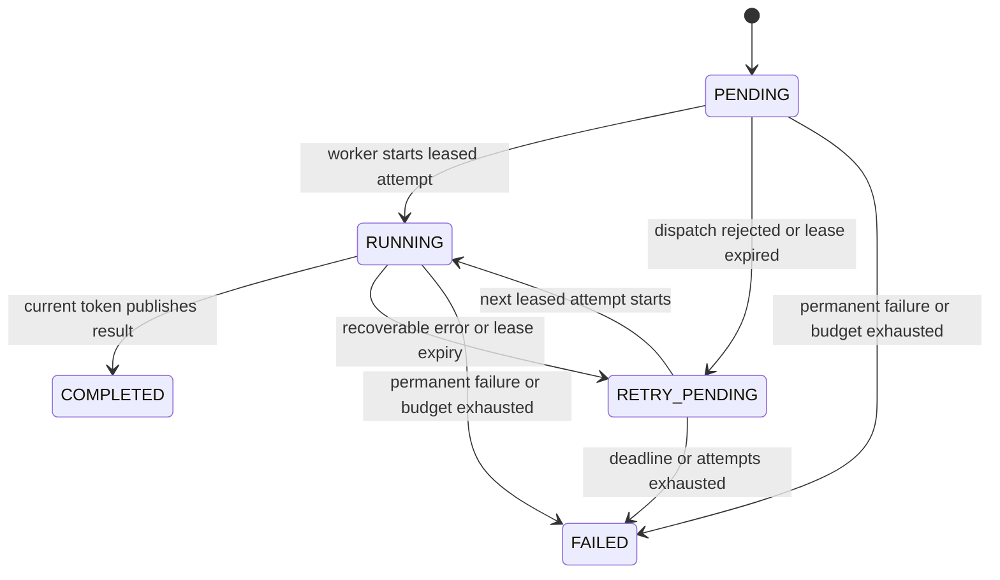

# State machine and resilience

Status: target failure model from phase 0. Phase 2 supplies volatile task processing and basic ownership checks; the Redis/recovery guarantees below remain planned. The current memory adapter boundary is recorded at the end.

## Guarantees and invariants

- A successful submission means task state and scheduling metadata were accepted atomically by Redis. Durability remains subject to the configured Redis persistence policy.
- At most one unexpired attempt token is authoritative for a task at a time. Lease ownership is not proof that a previous CPU computation has stopped.
- A task result is accepted only from its current, unexpired, worker-bound token. A conflicting result cannot overwrite a terminal state.
- A retry uses a fresh fencing token and increments a persisted attempt counter. Matching RPC replays do not allocate another attempt.
- At-least-once processing allows repeated computation. Local pure workloads avoid repeated external effects. Exactly-once execution is not promised.
- All queues, concurrency, retries, deadlines, input sizes, and result sizes have finite bounds.

## Lifecycle

Leasing is metadata, not an extra public state: a reserved task remains PENDING or RETRY_PENDING until StartTask succeeds. AcquireTask removes its ready-queue entry and records the lease atomically, preventing another router reserving it. It increments attempts even if dispatch later fails, bounding failures before execution as well as processor failures.

| Current state | Event | Result |
| --- | --- | --- |
| PENDING / RETRY_PENDING, no active lease | Eligible acquisition | Same state; new token, increment attempts, remove ready entry |
| PENDING / RETRY_PENDING, valid lease | Start by an admitted worker | RUNNING; bind worker instance |
| RUNNING | Start replay by same token and owner | No state change; no second local execution |
| RUNNING, valid owned lease | Renew | Same state; expiry extends within global deadline |
| RUNNING, valid owned lease | Complete | COMPLETED; record result and terminal retention |
| Leased nonterminal state | Recoverable failure or expiry | RETRY_PENDING if budget remains; otherwise FAILED |
| Any nonterminal state | Permanent error or global deadline | FAILED |
| COMPLETED / FAILED | Matching publication replay | Return retained outcome |
| Any state | Stale token, wrong owner, incompatible replay | Reject without mutation |

Terminal states cannot transition back to active states. Administrative task cancellation is outside the initial public API.

## Initial policy values

| Policy | Default |
| --- | --- |
| Maximum business attempts | 3, including initial acquisition |
| Retry delay after failure number n | Uniform jitter between 50% and 100% of `min(30 s, 500 ms * 2^(n-1))` |
| Global task deadline | 10 minutes after creation |
| Per-execution maximum | 30 seconds including queueing |
| Lease duration / renewal interval | 15 seconds / 5 seconds |
| Terminal task and idempotency retention | 24 hours after terminal transition |
| Transport attempts | At most 2 for eligible operations within one parent budget |
| Breaker opening threshold | 5 consecutive logical transient call failures |
| Breaker initial cooldown | 10 seconds |
| Half-open probes | 1 concurrent logical request |
| Worker shutdown grace | 40 seconds; Kubernetes termination grace 45 seconds |

These defaults are configurable within validated bounds and must be reviewed after real measurements. The 30-second backoff cap is defensive; with only three attempts the default delays never reach it. Retry schedules and task/lease deadlines are persisted and evaluated using Redis time.

## Failure handling

| Scenario | Intended behavior and recovery |
| --- | --- |
| Submission response lost | Retry with same key; return existing task without duplicate queue insertion |
| Router dies before dispatch | Lease expires; restarted router's acquisition sweep schedules a bounded retry |
| Worker rejects saturated execution | No StartTask; router reports pre-start rejection and schedules bounded retry |
| Execution RPC response lost | Router reads state; completed outcome wins, live worker ownership is preserved |
| Worker dies during processing | Lease expires; another attempt is scheduled, or task becomes FAILED |
| Old worker resumes after expiry | Renew/completion rejected by token/expiry check; local computation stops cooperatively |
| Redis unavailable | No new successful submissions or starts; workers cancel after inability to maintain leases; readiness fails where necessary |
| State Service crashes after committing completion | Retried same-token completion returns retained terminal outcome |
| Router unavailable | Submission returns 503 within deadline; existing workers may finish and queries may still succeed |
| Global task deadline expires in queue | Bounded maintenance marks FAILED and removes scheduling entries |
| Retries exhausted | FAILED, sanitized final reason and attempt count retained |
| Shutdown | Stop admission, mark unready, drain within grace, cancel remaining work, release resources in owned order |

On transient State Service failures, workers may retry renew/publication within their budgets, but cannot assume success. They stop processing if the last confirmed lease is no longer safely valid. An in-flight mutation that succeeds after the caller times out is resolved through idempotent replay or a subsequent read.

Redis disconnection does not itself prove that a lease is valid or expired; the authoritative decision is made by Redis time once communication resumes. Computations may overlap during partitions. Fencing protects accepted state, not all physical execution.

## Circuit breakers and backpressure

Breakers belong to outbound logical dependencies and count final transient failures after bounded transport attempts. Validation errors, business failures, and ordinary saturation do not count as connectivity failures. A worker-channel breaker opens only on dependency-wide unavailability; one unreachable worker must not disable healthy peers.

When open, calls fail promptly. A single half-open request determines recovery; failure reopens the breaker. Transport deadlines and task attempt budgets remain active in every breaker state. Do not acquire new task leases while worker dispatch is known unavailable, so an outage does not burn attempts through tight polling.

Configure a maximum retained active-task count and reject new submissions before Redis memory pressure. Router in-flight limits, worker bounded queues, and REST admission limits prevent unbounded buffering. Every nonempty worker queue contributes to the 30-second execution budget.

## Retention, persistence, and cleanup

The global deadline protects active tasks from living indefinitely. Terminal transition schedules cleanup 24 hours later; idempotency mappings live at least until the corresponding terminal retention ends. Index cleanup and task deletion occur through validated atomic maintenance operations. No automatic expiration may remove the dedup record of an active task.

If maintenance is delayed, reads and mutations must still enforce logical expiry. A read of a globally expired active task finalizes or reports its FAILED state through the owning State Service. An expired terminal record is treated as NOT_FOUND even before physical cleanup. Idempotent creation checks logical retention before reusing an old mapping.

Configure Redis AOF with a documented fsync mode and a persistent volume. Recovery tests must include actual restart behavior, but a single Redis primary remains a failure and durability boundary. `noeviction` avoids silent coordination-data eviction; it requires memory admission limits and explicit handling of rejected writes. Redis Lua does not roll back partial writes on script runtime errors, so scripts must prevalidate arguments/key types and be fault-tested under resource limits.

## Health and observability

Liveness reports process/control-loop progress and does not fail solely because Redis is down. Readiness includes required dependency checks with short deadlines and worker admission status. Shutdown fails readiness before draining. A permanently full or stalled executor must be detectable separately from ordinary temporary saturation.

Record request/operation duration histograms, retry counters, accepted completion/failure counts, current backlog, breaker state, active execution count, lease recoveries, stale-token rejections, and service availability. Attribute executions to worker instances. Log lifecycle changes with task/correlation IDs and sanitized errors; keep high-cardinality identifiers out of metric labels.

Each resilience scenario will assert the authoritative final task state, finite completion or failure time, attempt limit, and absence of stale overwrites. A successful final state alone is insufficient evidence that recovery was safe.

## Phase 2 memory adapter

The target recovery model above is not implemented by the phase 2 memory adapter. It supports one attempt, guarded ownership, renewal, matching completion replay, bounded worker token retention, and terminal failure on lease/task expiry. State loss discards all tasks and keys. There is no Redis, retry scheduling, circuit breaker, or restart recovery yet. Gateway readiness checks the router and State Service; internal gRPC health currently describes local registration. See [the implementation boundary](grpc-contracts.md#phase-2-implementation-boundary).
